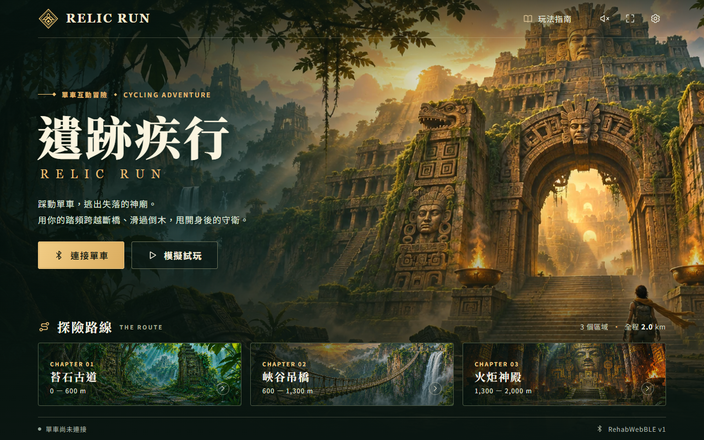
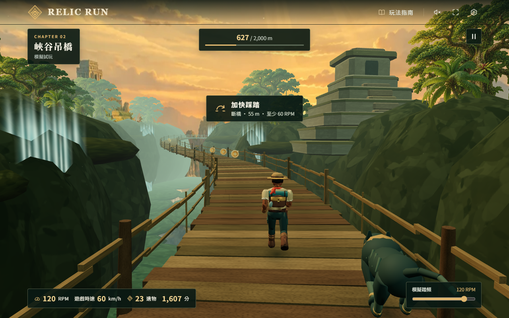

# 遺跡疾行 · Relic Run

**[在 GitHub Pages 開始遊玩](https://hplin50643.github.io/rehab_temple_escape/)**

用復健單車的飛輪轉速控制探險者，在石豹守衛的追趕下跑完 2 公里。沿途穿越苔石古道、峽谷吊橋與火炬神殿。遊戲採背後跟拍的即時 3D 視角，玩家可以雙手握著車把完成整段旅程。



## 開始遊玩

線上版開啟後可直接選「模擬試玩」或「連接單車」。如需離線遊玩，從 GitHub 下載原始碼後先執行 `pnpm install --frozen-lockfile` 與 `pnpm build`。已有 `dist/` 的 Windows 工作目錄可直接雙擊 **Play.cmd**。遊玩期間請保留啟動器視窗。

其他平台或終端機可在本目錄執行以下命令，再前往 [本機遊戲](http://127.0.0.1:4174/rehab_temple_escape/)。

```sh
node tools/static-server.mjs
```

- **模擬試玩**會立即開始。畫面右下方的踏頻滑桿模擬單車輸入，可體驗起跑、加速、滑行與停踩。
- **連接單車**會打開裝置選擇器。使用支援 Web Bluetooth 的 Chrome 或 Edge，選擇 `RehabWebBLE`，再按「開始逃亡」啟動機台。實機連線需要 localhost 或 HTTPS。
- **唯讀遊玩**適合已經由機台面板或其他控制器啟動的單車。網頁接收轉速，啟停由原控制端負責。

## 跑酷操作

| 路況 | 踩踏方式 | 遊戲反應 |
| --- | --- | --- |
| 一般路段 | 依自己節奏踩踏 | 角色自動循線轉彎，踏頻越高，跑速越快 |
| 斷橋 | 達到設定的舒適踏頻 | 角色自動跳過缺口 |
| 倒木 | 繼續踩踏並降至舒適踏頻的 85% 以下（含） | 角色滑過倒木 |
| 想歇腳 | 停踩，或按暫停鍵 | 0 RPM 凍結里程與踩踏時間；暫停鍵也會在受控模式停止機台 |

舒適踏頻預設為 60 RPM，可在齒輪選單調整。舒適踏頻對應遊戲時速 30 km/h，上限為 60 km/h。障礙前 80 公尺開始提示目標 RPM。成功通過能收集額外遺物、累積連擊；失誤讓守衛追近，玩家仍能繼續。全程共有 14 道障礙與 77 件遺物。音效、全螢幕、畫質與減少鏡頭動態都可在遊戲中調整。



## 單車通訊

沿用同一工作區《星際單車》使用的 Rehab ESP32 WebBLE v1。瀏覽器讀取 INFO、接收分片通知，使用 `machine.rpm` 與 `machine.age28_ms` 判定飛輪轉速。裝置回報年齡加上本機經過時間達 5 秒時，遊戲凍結並保留進度。恢復訊號或重新連線後，由玩家按「繼續逃亡」恢復。

受控模式在開始時取得 30 秒租約，持有期間每 10 秒續租；暫停、結束及切換到背景時依序發送 `stop` 與 `release`。停止未獲確認時顯示提示並中斷 GATT 連線，由韌體接手斷線處理。跑酷中的坡道與碰撞只影響遊戲。唯讀模式不啟停機台。協定與美術來源見 [素材與來源](ASSETS.md)。

## 開發與驗證

開發與 GitHub Pages 發布採用 Node.js 24 與 pnpm 11.25.0。

```sh
pnpm install --frozen-lockfile
pnpm dev
pnpm test
pnpm build
pnpm exec playwright install chromium
pnpm test:browser
```

開發網址為 [本機開發頁](http://127.0.0.1:5174/)。`pnpm build` 會執行型別檢查，並將網頁、美術和 Three.js 打包至 `dist/`，可放在靜態網站的子路徑。使用已安裝的 Edge 跑瀏覽器測試時，可將 `CHROMIUM_PATH` 設為其可執行檔路徑。

推送至 `main` 後，GitHub Actions 會執行單元測試、型別檢查與建置，通過後將 `dist/` 發布到 GitHub Pages。[查看部署紀錄](https://github.com/hplin50643/rehab_temple_escape/actions/workflows/pages.yml)

單元測試涵蓋速度換算、零轉速、兩種障礙門檻、漏收獎勵、終點結算、GATT 分片、租約與失訊。瀏覽器測試操作正式建置的首頁、模擬踏頻與人工 GATT 裝置，檢查三種視窗寬度、兩公里通關、裝置啟停、斷線及重連。此處的遊戲截圖使用模擬資料。實體單車的轉速與實際啟停反應需在機台上確認。
